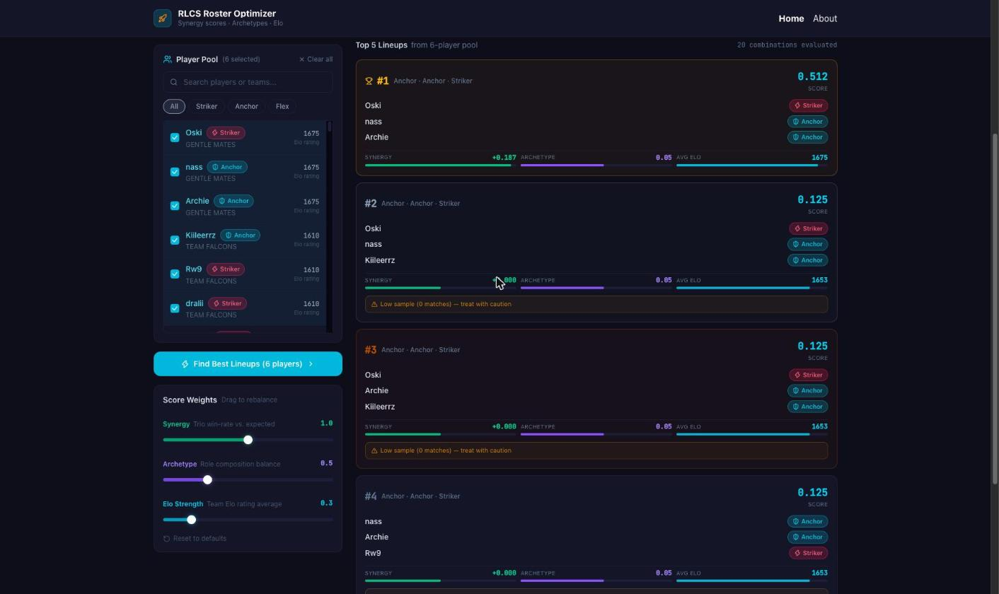
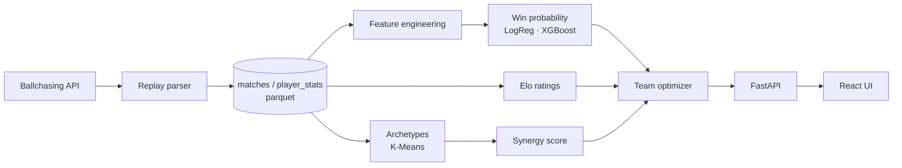

<div align="center">

# RLCS Roster Optimizer

**Pick the best three-player Rocket League roster from the pro scene, using Elo, player archetypes and a synergy model trained on real RLCS replays.**

[](https://rlcs-roster-optimizer.alexandergarcia.xyz/)

[](https://github.com/asg5704/rocket-league-predictor/actions/workflows/ci.yml)
[](https://github.com/asg5704/rocket-league-predictor/actions/workflows/pip-audit.yml)


[](LICENSE)

[Live demo](https://rlcs-roster-optimizer.alexandergarcia.xyz/) ·
[How it works](#how-it-works) ·
[Quickstart](#quickstart) ·
[API](#api) ·
[Blog series](https://alexandergarcia.dev/projects/rlcs-roster-optimizer#the-blog-series)

</div>

---

## Overview

Given a pool of professional Rocket League players, the optimizer ranks every possible trio and tells you which three would make the strongest team. It is an end-to-end data science and engineering project: raw replays go in one end and a deployed web app comes out the other.

- **Real pro data.** Replays from RLCS tournaments, pulled from the [Ballchasing](https://ballchasing.com) API. Ranked ladder matches are out of scope.
- **Three ideas combined.** Each trio is scored on the players' own Elo, the mix of player archetypes, and a learned synergy score.
- **Honest about its limits.** The win-probability model is only modestly better than a coin flip (see [Model performance](#model-performance)), and the README says so.
- **Production-shaped.** FastAPI backend, React frontend, a single multi-stage Docker image, CI dependency auditing, and 269 tests.

<p align="center">
  
</p>

## Features

|                         |                                                                                         |
| ----------------------- | --------------------------------------------------------------------------------------- |
| **Team optimizer**      | Search all `C(n, 3)` trios from the players you select and rank them by composite score |
| **Elo ratings**         | Per-player and per-team ratings built from match results (start 1500, K = 32)           |
| **Player archetypes**   | K-Means clustering over 22 per-player statistics, with an interactive PCA scatter plot  |
| **Synergy score**       | Measures how well a trio's archetypes complement each other                             |
| **Win probability**     | Logistic regression and XGBoost baselines, evaluated with cross-validation              |
| **Retraining workflow** | Documented, incremental ETL for adding new tournaments ([ETL.md](docs/ETL.md))          |

## How it works



1. **Collect.** `src/data_collection` downloads replays by Ballchasing group with retry and exponential backoff, then parses them into match and player-stat tables.
2. **Featurize.** `src/features` turns raw stats into team-level features for modeling.
3. **Model.** `src/models` trains win probability, Elo, archetype and synergy models and persists them with joblib.
4. **Optimize.** The optimizer scores every candidate trio from the three signals above and returns a ranked list.
5. **Serve.** FastAPI exposes the models, and the React app calls it. In production, one process serves both.

## Model performance

Cross-validated on RLCS World Championship 2026 data (328 matches, 121 players, 45 teams):

| Model   | Accuracy | ROC-AUC |
| ------- | -------- | ------- |
| XGBoost | 55.7%    | 0.60    |

Pro matches are close by nature, and the dataset is small. The model carries a real but weak signal, so treat the output as a ranking aid and not a betting oracle. Synergy scores are also in-sample: the optimizer favors historically strong trios and does not make forward predictions. Every retrain is logged on the app's About page.

## Quickstart

### Prerequisites

- Python 3.14
- Node.js 22 and [pnpm](https://pnpm.io)
- A [Ballchasing API key](https://ballchasing.com/upload) (only needed to collect new data; the trained models and processed data are included)

### Run locally

```bash
git clone https://github.com/asg5704/rocket-league-predictor.git
cd rocket-league-predictor

# Backend
python -m venv .venv && source .venv/bin/activate
pip install -r requirements.txt
PYTHONPATH=. uvicorn src.api.main:app --reload      # http://localhost:8000

# Frontend (second terminal)
cd frontend
pnpm install
pnpm dev                                            # http://localhost:5173
```

Vite proxies `/api/*` to port 8000, so no ports are hardcoded in the frontend.

### Run with Docker

One multi-stage image builds the frontend and serves it, along with the API, from a single uvicorn process.

```bash
docker build -t rlcs-optimizer .
docker run -p 8000:8000 -e APP_ENV=production rlcs-optimizer
```

Open <http://localhost:8000>. The container honors a `PORT` environment variable (default 8000), which is how platforms like Railway assign ports.

### Run the tests

```bash
PYTHONPATH=. pytest
```

## API

| Method | Endpoint           | Description                            |
| ------ | ------------------ | -------------------------------------- |
| `GET`  | `/api/players`     | Players available to the optimizer     |
| `POST` | `/api/optimize`    | Rank trios from a selected player pool |
| `GET`  | `/api/elo-ratings` | Team leaderboard (roster mean of player Elo) |

With the backend running, interactive docs are served by FastAPI at `/docs` unless disabled in production.

## Project structure

```
.
├── src/
│   ├── api/              FastAPI app and request/response schemas
│   ├── data_collection/  Ballchasing client, batch downloader, replay parser, player registry
│   ├── features/         Feature engineering (also runnable as a CLI)
│   └── models/           Win probability, Elo, archetypes, synergy, team optimizer
├── frontend/             React + Vite + TypeScript + Tailwind + TanStack Router
├── data/
│   ├── models/           Trained model artifacts
│   ├── processed/        Parquet tables used at runtime
│   └── players/          Hand-curated pro player registry
├── tests/                269 pytest tests
├── Dockerfile            Multi-stage build: frontend, trimmed Python deps, slim runtime
└── docs/                 ETL.md (retraining guide) and README screenshots
```

## Tech stack

- **Data and ML:** pandas, scikit-learn, XGBoost, joblib
- **Backend:** FastAPI, uvicorn, Pydantic
- **Frontend:** React 19, TypeScript, Vite, Tailwind CSS 4, Radix UI, TanStack Router, Recharts
- **Infra:** Docker, Railway, Cloudflare, GitHub Actions (weekly `pip-audit` on production and dev dependencies)

## Retraining on new data

Adding a tournament is a short, incremental process: find a Ballchasing group, download and parse only the new replays, rebuild features, and retrain. See [ETL.md](docs/ETL.md) for the full checklist.

## License

Released under the [MIT License](LICENSE). The license covers this repository's code, not the underlying Ballchasing replay data.

## Acknowledgements

- Replay data from [Ballchasing](https://ballchasing.com) and the community members who upload RLCS groups.
- Player and team history cross-checked against [Liquipedia](https://liquipedia.net/rocketleague).
- Not affiliated with Psyonix, Epic Games or the RLCS.
